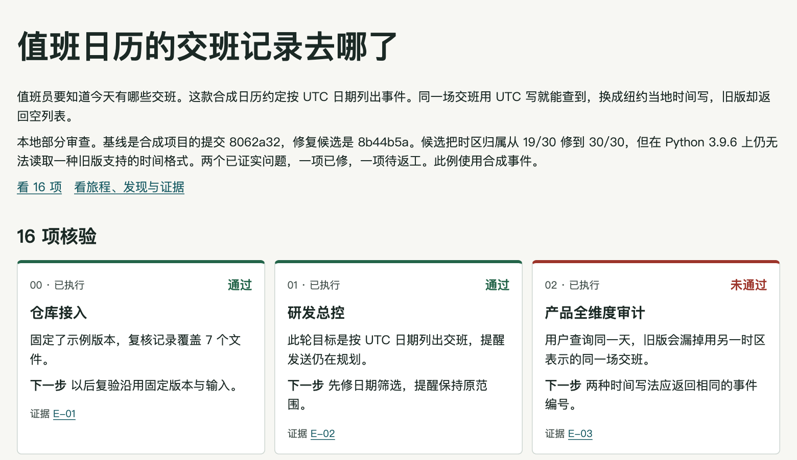

# AI Development OS

Give Codex or Claude Code a product repository, a local checkout, or a handoff from another development agent. The skill follows actual user journeys, records the evidence for each finding, and groups the fixes into batches you can accept or send back.

[Download the skill](https://github.com/delu543/ai-development-os/releases/latest/download/ai-development-os.zip) · [Read a sample audit](examples/calendar-audit.md) · [中文](README.md) · [MIT license](LICENSE)

## What a review catches

A fixture in this repository lists shift handovers by UTC date. Its existing unit test passed. A shift at `2026-11-25T00:00:00+00:00` appeared in the results, while the same instant written as `2026-11-24T19:00:00-05:00` disappeared. The repair passed all 30 UTC membership checks. A separate check on Python 3.9.6 found a previously accepted timestamp format that the repair could no longer read. That acceptance item stayed open. [Original counterexample](tests/evidence/calendar-comparison.json) · [Repair and regression evidence](tests/evidence/roundtrip-results.json)

[](examples/calendar-audit.md)

## First review

1. Download the release ZIP and unzip it. Place the entire `ai-development-os` directory in the personal skill folder shown below. For a one-off trial you can also ask your agent to read the extracted `SKILL.md`. [Release downloads and checksums](https://github.com/delu543/ai-development-os/releases/latest)
2. In a new chat, invoke the skill and provide the product repository, ideally at a fixed commit. A local path also works. The packaged prompts, templates and sample report are written in Chinese. Include your preferred report language in your request.
3. Read the 16-row dashboard and any product-specific checks. Choose **A** for prioritized advice, **B** for one task packet to send to your developer, or **C** for the current agent to implement and verify the selected changes. With B, send back one receipt per batch. The reviewer checks each original acceptance criterion and the affected existing behavior.

| Host | Personal installation | Example request |
| --- | --- | --- |
| Codex | `~/.agents/skills/ai-development-os/` | `$ai-development-os Review <product repository or local path> and report in English.` |
| Claude Code | `~/.claude/skills/ai-development-os/` | `/ai-development-os Review <product repository or local path> and report in English.` |

The review starts read-only. It covers repository inventory, product and interface behavior, algorithms, acceptance criteria, engineering gates, model evaluation, security, independent review, release readiness and user value. Each module records what was tested and what still needs evidence. Private repositories require access. External model calls, production work and sharing data follow the permissions of the project being reviewed. [Module index](ai-development-os/SKILL.md) · [Full sample report](examples/calendar-audit.md) · [Download the offline dashboard](https://github.com/delu543/ai-development-os/releases/latest/download/calendar-audit.html)

## Work on the project

The two helpers use the Python standard library. Repository inventory also uses Git. From a checkout, run the following checks.

```sh
python3 tests/test_coverage.py
python3 tests/test_audit_report.py
```

Bug reports with a small synthetic example are welcome. Use the private reporting form for security concerns. [Contributing](CONTRIBUTING.md) · [Open an issue](https://github.com/delu543/ai-development-os/issues/new/choose) · [Security policy](SECURITY.md) · [Changelog](CHANGELOG.md)

Copyright © 2026 delu543. The source, prompts, templates and packaged documentation are available under the MIT License. [Full license](LICENSE)
