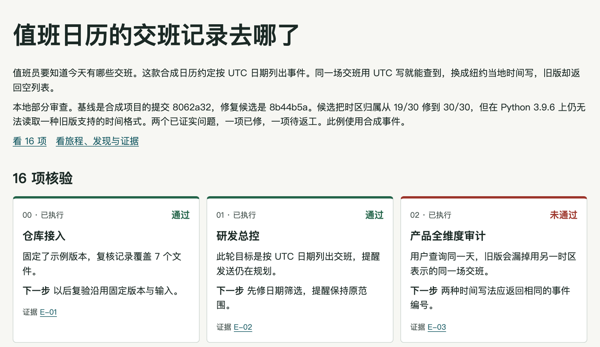

# AI Development OS

把一个产品仓库交给 Codex 或 Claude Code，查清用户能做成什么、哪里会失败、下一批先改什么。给一个仓库链接、本地路径，或上游开发 AI 的归档回执，就能开始。

[下载 Skill](https://github.com/delu543/ai-development-os/releases/latest/download/ai-development-os.zip) · [看一份完整报告](examples/calendar-audit.md) · [English](README.en.md) · [MIT 许可证](LICENSE)

## 先看它能查出什么

一个值班日历约定按 UTC 日期列出交班。原有单测通过，同一场交班写成 `2026-11-25T00:00:00+00:00` 可以查到，写成等价的 `2026-11-24T19:00:00-05:00` 却从结果里消失。修复后，30 项日期归属判断全部正确。复验又发现，旧版本能读取的时间格式在 Python 3.9.6 上报错，于是只把兼容性问题退回开发者。[对照输入与实际输出](tests/evidence/calendar-comparison.json) · [修复前后的复验记录](tests/evidence/roundtrip-results.json)

[](examples/calendar-audit.md)

这份合成案例包含 16 项基础审查、2 项日历专项以及对应的证据。可以在 GitHub 上阅读全文，也可以下载看板，在浏览器里点证据编号。[完整报告](examples/calendar-audit.md) · [下载离线 HTML 看板](https://github.com/delu543/ai-development-os/releases/latest/download/calendar-audit.html)

## 开始使用

**1. 装一次。** 下载 ZIP，解压后将整个 `ai-development-os` 文件夹放到对应工具的个人技能目录，确认该文件夹里直接有 `SKILL.md`。只想试一次，也可让 AI 读取解压目录中的 `SKILL.md`。[下载最新版](https://github.com/delu543/ai-development-os/releases/latest) · [安装与项目级用法](ai-development-os/README.md)

| 在哪里用 | 放到哪里 | 在新聊天里发送 |
| --- | --- | --- |
| Codex | `~/.agents/skills/ai-development-os/` | `$ai-development-os 请审查 <产品仓库链接或本地路径>` |
| Claude Code | `~/.claude/skills/ai-development-os/` | `/ai-development-os 请审查 <产品仓库链接或本地路径>` |

**2. 给它产品版本。** 已有仓库时直接发链接，最好指向具体提交。本地项目也可以直接审。若希望把另一位开发 AI 手里的工作保存到 GitHub，把完整提示词发给它。它会更新对应仓库，或在确实没有时创建私有仓库。把返回的整份回执贴到审查窗口即可。[给原开发 AI 的完整提示词](ai-development-os/给原开发AI的提示词.txt)

**3. 读报告，选一批改动。** 聊天里会列出 16 行看板，每行给执行状态、验收结论、实际观察和下一步。仓库有独特的业务承诺时会追加专项。报告同时列出已证实问题、待验证的改进机会、通过的关键行为以及尚缺的证据。[全部模块](ai-development-os/SKILL.md) · [报告模板](ai-development-os/templates/AUDIT_REPORT.md)

| 你想怎样继续 | 选项 | 接下来会发生什么 |
| --- | --- | --- |
| 先决定哪些值得做 | A | 拿到按影响排序的建议、取舍和验收条件 |
| 让原开发 AI 修改 | B | 拿到一张整批任务单。改完只转发一个回执，逐项验收、关闭或退回 |
| 就在当前窗口改 | C | 当前 AI 在选定范围修改，并检查新版本和受影响的旧行为 |

## 它覆盖哪些环节

| 范围 | 对应内容 |
| --- | --- |
| 00 至 04 | 固定版本与全仓盘点、研发总控、产品完整旅程、UI/UX、算法与技术 |
| 05 至 09 | 验收契约、基线与需求追踪、自动化门禁、AI Evals、安全与隐私 |
| 10 至 15 | 正向验收、反例验证、GitHub 交接、跨模型盲审、发布恢复、真实用户价值 |

首审默认只读。Git 对象对得上、程序构建成功、用户能够完成任务，各自需要对应证据。缺少真机、第二模型、生产环境或真实用户资料时，会说明哪些结论仍待验证。私有仓库需要审查者已有读取权限，跨模型传输和计费调用沿用项目的授权范围。

## 复现与参与

两个本地工具只依赖 Python 标准库，仓库盘点另需 Git。可以从源码运行既有检查，或把示例报告转成自己的离线看板。示例含待补证项目，报告工具会生成 HTML 并返回状态码 1。[本地工具说明](ai-development-os/README.md) · [验证记录](验证记录.md)

```sh
python3 tests/test_coverage.py
python3 tests/test_audit_report.py
python3 ai-development-os/scripts/check_audit.py examples/calendar-audit.md --html calendar-audit.html
```

欢迎提交带有合成用例的改进，尤其是能说明某个模块漏查了什么的实例。普通问题可提交 Issue，涉及安全或隐私的材料请走私密报告入口。[贡献指南](CONTRIBUTING.md) · [问题反馈](https://github.com/delu543/ai-development-os/issues/new/choose) · [安全报告](SECURITY.md) · [更新记录](CHANGELOG.md)

Copyright © 2026 delu543。本项目的源码、提示词、模板和随包文档采用 MIT 许可证。分发时请保留版权和许可声明。[许可全文](LICENSE)
